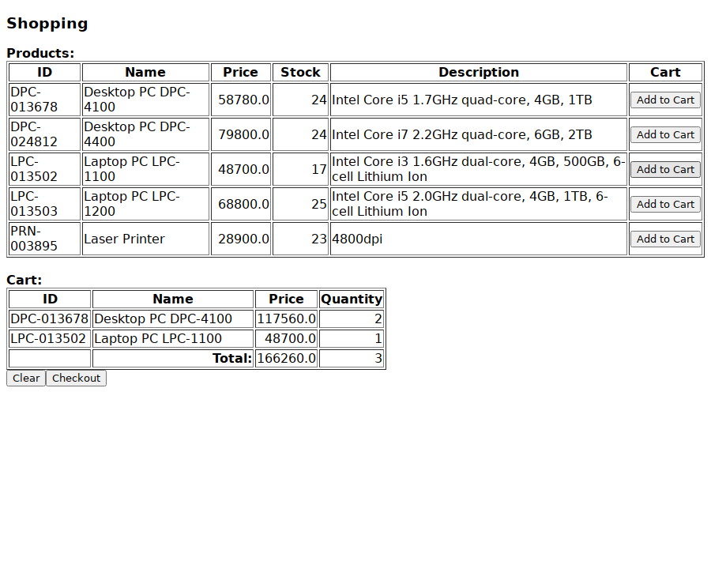

# jsf-shopping-cart-demo

[](https://github.com/annupuri/jsf-shopping-cart-demo/actions/workflows/build.yml)

*[English](README.md) | 日本語*

Jakarta Faces(Apache MyFaces)と Jakarta XML Binding で作成した、商品カタログと
ショッピングカートの小さな Web アプリケーションです。`war` パッケージとしてビルドでき、
`presentation` / `business` / `integration` / `common` にレイヤーを分けています。

## スクリーンショット

サンプルデータに対して商品を2つカートに入れた `/main.xhtml`(組み込み Jetty で配信):



## 構成

- `src/shopping/presentation` — CDI 管理の Faces Bean(`ProductController`、`CartController`)と
  カスタム `BigDecimal` コンバータ
- `src/shopping/business` — `ProductService` と JAXB バインドの `Product` モデル
- `src/shopping/integration` — カタログを XML ファイルとして読み書きする `ProductDao`
- `src/shopping/common` — 小さな共通ユーティリティ
- `src/shopping/tool` — サンプル XML とスキーマを生成するスタンドアロンの `main` プログラム
- `WebContent` — Facelets ビュー(`main.xhtml`)、ウェルカムページ、CSS
- `test` — JUnit 5 のテストスイート

## 技術スタック

Java 21、Maven(`war` パッケージング)、Jakarta EE 10(`jakarta.*` 名前空間)。Jakarta
Faces 4.0 を Apache MyFaces 4 上で使用、CDI 4 は Weld、Jakarta XML Binding 4 は Glassfish
リファレンス実装、ロギングは SLF4J / Logback。テストは JUnit 5 / Mockito / JaCoCo。
Servlet 6.0 コンテナ(Tomcat 10.1 など)を想定。

## 設計

**レイヤリング。** Faces のコントローラは永続化ロジックを持ちません。`ProductController`
(`@RequestScoped`)と `CartController`(`@SessionScoped`)は `ProductService` に委譲し、
`ProductService` は各操作を `synchronized` ブロックで囲んで `ProductDao` にストレージを
委譲します。`ProductDao` はカタログ全体を JAXB で単一の `Products.xml` にマーシャリングします。

**注入用シーム。** `ProductDao` / `ProductService` / 両コントローラは、CDI と実行時の
アプリが使う引数なし・`getInstance()` の経路を維持しつつ、協力オブジェクトを受け取る
コンストラクタも公開しています。これによりテストは、実ファイルに触れず一時ディレクトリを
指す DAO を注入できます。

**データの場所。** カタログは作業ディレクトリからの相対で `./product_db/Products.xml` に
置かれます。`-Dshopping.dataDir=/some/path` で上書きできます。

**画面。** `main.xhtml` は単一の `<h:form>` です。*Add to Cart* は行の商品をそのまま
`#{cartController.addToCart(prd)}` に渡し、カート表を AJAX で再描画します。*Checkout* は
セッションのカート内容を発注し、更新後の在庫数を XML に書き戻します。

## ビルド

```
mvn package
```

で `target/jsf-shopping-cart-demo-<version>.war` が生成されます。ツールチェーンは
`.tool-versions` に [asdf](https://asdf-vm.com) 用として Temurin 21 と Maven 3.9.9 を
pin しています。

## テスト

```
mvn verify
```

で JUnit 5 スイートと JaCoCo のカバレッジチェックを実行します(行 80% / 分岐 70% を
下回るとビルド失敗。計測は生成モデルと `tool` プログラムを除外)。`mvn test` はテストのみ、
HTML レポートは `target/site/jacoco/index.html` に出力されます。

## 実行

```
mvn package jetty:run-war   # http://localhost:8080/ で配信
```

<http://localhost:8080/> がウェルカムページ、<http://localhost:8080/main.xhtml> が
カタログ画面です。最初は空で表示され、次のコマンドでサンプル商品 5 件を投入できます:

```
mvn compile exec:java      # product_db/Products.xml を書き出す
```

投入後にページを再読み込みし、*Add to Cart* でカートを作り *Checkout* で発注すると、
在庫数が減って `product_db/Products.xml` に保存されます。ストアのパスは Maven の実行
ディレクトリからの相対です。`-Dshopping.dataDir=/some/path` で変更できます。

組み込み実行ではなくデプロイする場合は、`war` を Tomcat 10.1 の `webapps` に配置します。

## 位置づけ

学習用プロジェクトです。もともと 2012 年ごろに Eclipse プロジェクトとして作成したもの
(`javax.faces` 名前空間の JSF 2.1、EclipseLink、log4j 1.2)を、アーキテクチャ(MyFaces
上の Faces、ファイルベースの XML ストア、サービス / DAO 分離)はそのままに、現行の
ツールチェーン(Java 21、Jakarta EE 10、モダンな Maven ビルド、JUnit 5、JaCoCo の
カバレッジゲート)へ移行したものです。

## スコープ

本番用ソフトウェアではありません。カタログはプロセス内ロックだけで保護された単一の XML
ファイル、カートは注文履歴のない Faces セッション状態で、認証はありません。

Issue でのバグ報告は歓迎しますが、機能開発は行っていません。

## ライセンス

MIT License — [LICENSE](LICENSE) を参照してください。
