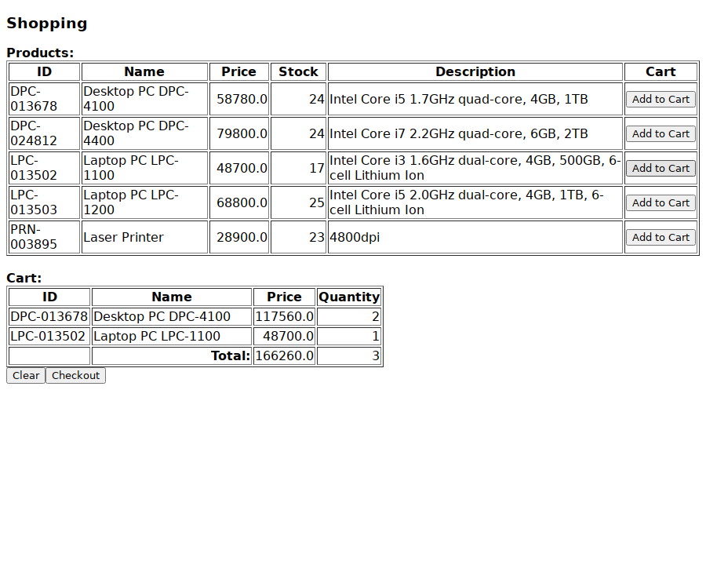

# jsf-shopping-cart-demo

[](https://github.com/annupuri/jsf-shopping-cart-demo/actions/workflows/build.yml)

*English | [日本語](README.ja.md)*

A small product-catalogue and shopping-cart web application built with Jakarta Faces
(Apache MyFaces) and Jakarta XML Binding. It builds to a `war` and layers cleanly into
`presentation` / `business` / `integration` / `common`.

## Screenshot

`/main.xhtml` after adding two products to the cart, served by embedded Jetty against the
sample data:



## Layout

- `src/shopping/presentation` — CDI-managed Faces beans (`ProductController`, `CartController`)
  and a custom `BigDecimal` converter
- `src/shopping/business` — `ProductService` plus the JAXB-bound `Product` model
- `src/shopping/integration` — `ProductDao`, which reads and writes the catalogue as an XML file
- `src/shopping/common` — small application utilities
- `src/shopping/tool` — standalone `main` programs that generate the sample XML and its schema
- `WebContent` — a Facelets view (`main.xhtml`), a welcome page, and CSS
- `test` — JUnit 5 test suite

## Stack

Java 21, Maven (`war` packaging), Jakarta EE 10 (`jakarta.*` namespace): Jakarta Faces 4.0
on Apache MyFaces 4, CDI 4 via Weld, Jakarta XML Binding 4 with the Glassfish reference
implementation, and SLF4J / Logback for logging. JUnit 5, Mockito and JaCoCo for tests.
Targets a Servlet 6.0 container such as Tomcat 10.1.

## Design

**Layering.** The Faces controllers hold no persistence logic. `ProductController`
(`@RequestScoped`) and `CartController` (`@SessionScoped`) delegate to `ProductService`,
which brackets each operation in a `synchronized` block and delegates storage to
`ProductDao`. `ProductDao` marshals the whole catalogue to a single `Products.xml` with JAXB.

**Injection seams.** `ProductDao`, `ProductService` and both controllers keep the
no-argument / `getInstance()` path that CDI and the running app use, and also expose a
constructor that takes its collaborator, so tests can inject a DAO pointed at a temporary
directory instead of touching real files.

**Data location.** The catalogue lives in `./product_db/Products.xml`, relative to the
working directory. Override it with `-Dshopping.dataDir=/some/path`.

**View.** `main.xhtml` is a single `<h:form>`. *Add to Cart* passes the row's product
straight to `#{cartController.addToCart(prd)}` and re-renders the cart table over AJAX;
*Checkout* orders whatever the session cart holds and writes the new stock back to the XML.

## Build

```
mvn package
```

produces `target/jsf-shopping-cart-demo-<version>.war`. `.tool-versions` pins the toolchain
for [asdf](https://asdf-vm.com): Temurin 21 and Maven 3.9.9.

## Test

```
mvn verify
```

runs the JUnit 5 suite and the JaCoCo coverage check (the build fails below 80% line /
70% branch, measured excluding the generated model and the `tool` programs). `mvn test` runs
just the tests; the HTML report is written to `target/site/jacoco/index.html`.

## Run

```
mvn package jetty:run-war   # serves http://localhost:8080/
```

Open <http://localhost:8080/> for the welcome page, or <http://localhost:8080/main.xhtml>
for the catalogue. It starts empty; load five sample products with

```
mvn compile exec:java      # writes product_db/Products.xml
```

and reload the page. Then use *Add to Cart* to build up the cart and *Checkout* to order it;
the stock counts drop and are saved back to `product_db/Products.xml`. The store path is
relative to the directory Maven runs in — override it with `-Dshopping.dataDir=/some/path`.

To deploy instead of running embedded, drop the `war` into a Tomcat 10.1 `webapps` directory.

## About

A learning project. It was first written as an Eclipse project around 2012 (JSF 2.1 on the
`javax.faces` namespace, EclipseLink, log4j 1.2); this repository revives it on a current
toolchain — Java 21, Jakarta EE 10, a modern Maven build, JUnit 5 and a JaCoCo coverage
gate — while keeping the original architecture (Faces on MyFaces, a file-backed XML store,
a service/DAO split).

## Scope

Not production software. The catalogue is a single XML file guarded only by an in-process
lock, the cart is Faces session state with no order history, and there is no authentication.

Bug reports via issues are welcome, but it is not under active feature development.

## License

MIT License — see [LICENSE](LICENSE).
